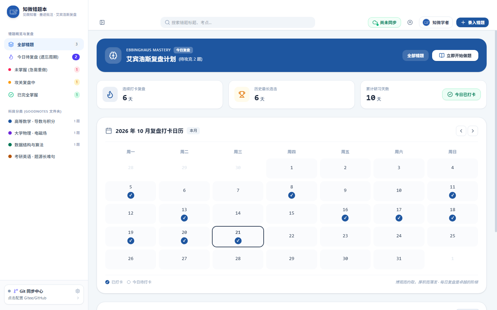
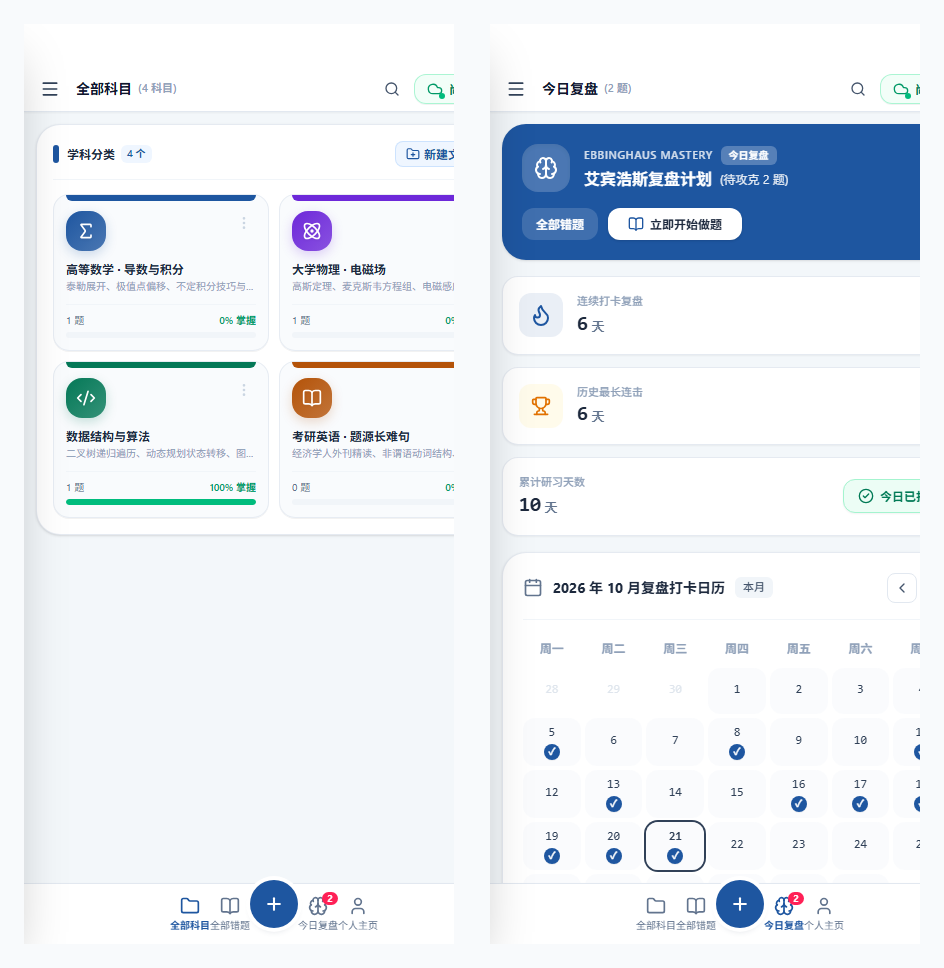

<div align="center">

  

  # 知微错题本 (ZhiWei Note)
  
  **见微知著 · 省思改错 · 本地优先 · 登峰造极**

  一款专为学生、考研考公党、竞赛生与终身学习者打造的**跨平台本地优先（Local-First）智能错题管理与深度复盘系统**。<br/>
  融合 **GoodNotes 拟物学科体系**、**艾宾浩斯复盘与连续打卡日历**、**Apple Pencil 真实压感手写演练**、**Markdown + LaTeX 公式多模态精析** 与 **Git 免服务器私有云双向漫游**。

  <p align="center">
    <a href="https://github.com/xuewexin/zhiwei-notebook/releases/latest"></a>
    
    
    
    
    
  </p>

  <p align="center">
    <a href="#-最新版本极速下载-v165"><b>🚀 极速下载</b></a> &nbsp;•&nbsp;
    <a href="#-核心特色与功能矩阵"><b>✨ 核心特色</b></a> &nbsp;•&nbsp;
    <a href="#-全平台精选界面巡礼"><b>🖼️ 界面巡礼</b></a> &nbsp;•&nbsp;
    <a href="#-各端安装与使用指南"><b>📦 安装指南</b></a> &nbsp;•&nbsp;
    <a href="#-技术架构"><b>🛠️ 架构设计</b></a>
  </p>

</div>

---

## 📥 最新版本极速下载 (v1.6.5)

本项目提供全平台打包好的纯净安装包，无任何强制联网、无广告，下载即用：

| 平台 | 安装包名称 | 文件大小 | 适用设备与特性 | 直接下载链接 |
| :--- | :--- | :--- | :--- | :--- |
| 💻 **Windows 原生版** | `zhiwei-notebook-v1.6.5-windows.exe` | ~1.9 MB | **Windows 独立原生桌面软件**（双击即开、原生目录浏览、官方发布页直达升级） | [点击下载 EXE](https://github.com/xuewexin/zhiwei-notebook/releases/download/v1.6.5/zhiwei-notebook-v1.6.5-windows.exe) |
| 💻 **Windows 便携版** | `zhiwei-notebook-v1.6.5-windows-portable.zip` | ~1.3 MB | Windows 绿色免安装压缩包（解压即开，支持放入 U 盘随身携带） | [点击下载 ZIP](https://github.com/xuewexin/zhiwei-notebook/releases/download/v1.6.5/zhiwei-notebook-v1.6.5-windows-portable.zip) |
| 🤖 **Android 原生版** | `zhiwei-notebook-v1.6.5-android.apk` | ~4.0 MB | 安卓手机 / 安卓平板（典雅纯色、防键盘遮挡、复盘日历、SAF 目录选择） | [点击下载 APK](https://github.com/xuewexin/zhiwei-notebook/releases/download/v1.6.5/zhiwei-notebook-v1.6.5-android.apk) |
| 🍎 **iPadOS / iOS** | `zhiwei-notebook-v1.6.5-ipad.ipa` | ~3.4 MB | iPad 全系列 / iPhone（原生 ARM64 编译，支持爱思助手/巨魔商店免费侧载） | [点击下载 IPA](https://github.com/xuewexin/zhiwei-notebook/releases/download/v1.6.5/zhiwei-notebook-v1.6.5-ipad.ipa) |
| 🍎 **iPad 原生工程** | `zhiwei-notebook-v1.6.5-ios-xcode-project.zip` | ~1.8 MB | 包含完整 Xcode 工程源码，可在 Mac 电脑直接打开真机编译调试 | [点击下载工程 ZIP](https://github.com/xuewexin/zhiwei-notebook/releases/download/v1.6.5/zhiwei-notebook-v1.6.5-ios-xcode-project.zip) |
| 🌐 **iPad / PC 局域网版** | `启动iPad局域网极速连接.bat` | 脚本文件 | **免安装、免证书、永不过期**。iPad Safari 添加到主屏幕秒变全屏桌面 App | [查看使用步骤](#-方案二ipad-专属-pwa-桌面原生体验免签名) |
| 💻 **本地运行脚本** | `启动错题本.bat` | 脚本文件 | 双击脚本即开，搭配本地 Node.js 极速做题 | [查看运行方法](#-windows-桌面端使用指南) |

---

## ✨ v1.6.5 重大升级亮点

1. 🛡️ **移动端键盘遮挡底栏与模态弹窗深度修复**：
   - 彻底修复了手机端输入文本时软键盘弹起并将底栏一并顶起的视觉缺陷；
   - 引入动态键盘与活动输入监听体系：软键盘唤起或模态窗开启时，移动端底栏智能隐藏；键盘收起即时归位；
   - 文件夹新建与编辑弹窗提升为全局顶级 Portal 渲染（`z-[9999]`），彻底杜绝内容被底栏截断或叠放异常。
2. 📅 **今日复盘打卡日历表与连续学习天数（艾宾浩斯复盘引擎）**：
   - 全新打卡日历系统：记录并直观展示当前连续打卡天数（Streak）、最长连续天数以及累计复盘总天数；
   - 交互式月度打卡日历：清晰标明过往打卡足迹与今日状态，点击一键完成今日学习复盘打卡；
   - 今日艾宾浩斯待攻克错题与复盘进度深度整合，学思并重、温故知新。
3. 🎨 **经典纯色典雅设计，彻底剔除渐变色与杂色**：
   - 重塑 6 款沉静典雅的书卷纯色（知微蓝、紫罗兰、翡翠绿、琥珀橙、蔷薇红、水墨灰）；
   - 彻底删除全站所有线性/径向渐变，全部采用纯色（Solid Flat）现代设计；
   - 主题配色全量联动顶部导航、底栏、悬浮按钮、全部错题列表、复盘卡片与错题详情，实现 100% 全局自适应。
4. 🌐 **版本更新直达 GitHub 官方发行页面**：
   - 针对部分手机厂商系统直接下载 APK 后拦截并不提示安装的问题，更新时直接唤起系统外部默认浏览器打开 GitHub Releases 官方版本发行页面，由用户在最稳定安全的官方页面直接选择对应安装包下载安装。
5. 📂 **个人主页设置卡片默认收起折叠**：
   - 个人主页下的 6 大模块（主题配色、背景壁纸、文件存储、AI助教、关于与更新、联系反馈）默认全部收起折叠，点击标题即可丝滑展开，界面清爽整洁。
6. 📁 **文件存储设置极简重构**：
   - 剔除冗余预设，仅保留核心“文件夹位置设置（输入框+原生浏览选择+保存）”以及“数据备份恢复与 Git 同步”。
7. 🏷️ **全站清除 Emoji 标签，全面统一为规范矢量图标**：
   - 剔除 📱、💻、📮、✏️ 等杂乱 emoji，全量换成精致规范的 Lucide 矢量 SVG 标志。
8. 🌅 **软件开屏等待页全新重构**：
   - 彻底重构进入软件的等待过渡页面，去除老旧黑白与渐变，纯平极简设计，实时毫秒级同步当前主题配色。

---

## 🌟 核心特色与功能矩阵

<div align="center">

| 功能维度 | 核心特性 | 学习场景与价值 |
| :--- | :--- | :--- |
| 📅 **艾宾浩斯记忆与打卡日历** | • 艾宾浩斯临界点智能排程<br/>• 连续打卡天数（Streak）统计<br/>• 交互式月度足迹日历网格 | 遵循记忆遗忘规律，避免“录了不看”的死循环；以连击天数激发学习成就感 |
| 📂 **GoodNotes 拟物学科体系** | • 无限级学科与考点层级<br/>• 8 款书卷封皮与专属矢量徽章<br/>• 动态掌握度环形进度盘 | 搭建结构化知识大厦，从宏观学科（高数/物化/算法）到微观考点井井有条 |
| 📝 **Markdown + LaTeX 多模态笔记** | • KaTeX 数学公式实时解析<br/>• 多语言代码块语法高亮<br/>• 标准答案折叠（防剧透自测） | 完美满足数理推导、算法分析、文科长难句等高阶题型的精细化整理诉求 |
| ✍️ **压感真实手写草稿演练板** | • 硬件级 PointerEvent 压感<br/>• 手掌防误触（Pen Only 模式）<br/>• 多页草稿推导保存与归档 | 还原纸质笔记本演算推导触感，原汁原味记录考场推导灵感与顿笔痕迹 |
| 🔄 **多次做题演练历程分区** | • 建立多次复盘时间轴<br/>• 结果/耗时/演算草稿/反思记录<br/>• 动态掌握度状态机联动 | 告别“做过一遍就算学会”的盲目，客观记录同一道题从不会到精通的全程蜕变 |
| ☁️ **本地优先 + Git 免服务器云同步** | • 100% 离线可用，断网秒开<br/>• 支持 GitHub / Gitee 私有仓库<br/>• 三端互通，无中心化收费服务器 | 数据 100% 归属于你，绝不依赖第三方可能停运的云服务，隐私与安全坚如磐石 |
| 🎨 **学者纯色典雅设计与壁纸** | • 6 款舒适耐看的沉静纯色<br/>• 自定义本地背景壁纸与透明度<br/>• 全平台 100% 全局自适应 | 拒绝刺眼荧光与杂乱渐变，打造沉浸、专注、纯粹的书卷学习空间 |
| 🛡️ **覆盖式无损升级保障** | • 升级逻辑与本地数据库物理隔离<br/>• 自动清理旧构建缓存<br/>• 升级过程绝不损坏或丢失本地错题 | 放心升级新功能，每一次更新都安心无忧 |

</div>

---

## 🖼️ 全平台精选界面巡礼

<div align="center">

### 💻 宽屏桌面端与 iPad 平板大屏视图
*拟物化 GoodNotes 学科封面、多级目录折叠导航、搜索与 Git 状态面板*


---

### 📖 错题精细研读与多模态复盘视图
*标准解析折叠防剧透、LaTeX 数学公式秒级渲染、历次演练做题记录与解题心得*


---

### 📅 艾宾浩斯复盘计划与连续打卡日历
*连续学习天数（Streak）徽章、历史最长连击、累计研习统计与月度足迹日历*



---

### 📱 移动端与手机竖屏触控专属设计
*左侧：手机端学科分类与错题卡片流 ｜ 右侧：艾宾浩斯复盘与连续学习打卡日历*



</div>

---

## 🚀 各端安装与使用指南

### 🤖 Android 安卓端安装
1. 在 Android 设备上下载 [**`zhiwei-notebook-v1.6.5-android.apk`**](https://github.com/xuewexin/zhiwei-notebook/releases/download/v1.6.5/zhiwei-notebook-v1.6.5-android.apk)；
2. 点击安装包，若系统提示请允许「允许安装来自此来源的应用」；
3. 安装完成后打开，即可畅享专门为手机端适配的自适应顶栏、防软键盘遮挡、相机扫题与双击返回体验。

---

### 🍎 iPadOS / iOS 端安装

#### 方案一：使用爱思助手安装原生 `.ipa`（最推荐 ⭐）
1. 下载 [**`zhiwei-notebook-v1.6.5-ipad.ipa`**](https://github.com/xuewexin/zhiwei-notebook/releases/download/v1.6.5/zhiwei-notebook-v1.6.5-ipad.ipa) 到电脑；
2. 用数据线将 iPad 连接到电脑，打开电脑端「爱思助手」；
3. 进入 **「工具箱」➔「IPA 签名」**，导入下载好的 `.ipa` 文件；
4. 选择 **「使用 Apple ID 签名」**，输入你自己的 Apple ID 即可免费签名并安装到 iPad；
5. 首次在 iPad 上打开时，进入「设置」➔「通用」➔「VPN 与设备管理」中点击「信任开发者证书」即可畅享！

#### 方案二：iPad 专属 PWA 桌面原生体验（免签名、永不过期）
1. 确保电脑与 iPad 连接在同一个 Wi-Fi 局域网下；
2. 电脑双击运行根目录下的 `启动iPad局域网极速连接.bat`；
3. 控制台会显示局域网访问地址（例如 `http://192.168.1.xxx:5173`）；
4. iPad 打开 Safari 访问该地址，点击右上角 **「分享」按钮 ➔「添加到主屏幕」**；
5. iPad 桌面自动生成专属高清图标，点击即可 100% 全屏独立运行，完美支持 Apple Pencil 压感手写与离线使用！

---

### 💻 Windows 桌面端使用指南

#### 方式一：直接运行 Windows 单文件版 EXE（最推荐 ⭐）
1. 下载 [**`zhiwei-notebook-v1.6.5-windows.exe`**](https://github.com/xuewexin/zhiwei-notebook/releases/download/v1.6.5/zhiwei-notebook-v1.6.5-windows.exe)（或下载绿色便携版 ZIP 解压）；
2. 直接双击打开即可运行！无需安装任何额外环境，独立桌面窗口、无浏览器地址栏干扰，内嵌高精度手写与本地数据引擎。

#### 方式二：一键批处理脚本启动
直接双击项目根目录下的 **`启动错题本.bat`**，系统将自动拉起本地数据存储服务与浏览器前端界面！

#### 方式三：开发者源码启动
```bash
# 1. 克隆代码仓库
git clone https://github.com/xuewexin/zhiwei-notebook.git
cd zhiwei-notebook

# 2. 安装依赖
npm install

# 3. 启动开发服务器 (自动打开 http://localhost:5173)
npm run dev

# 4. 构建生产产物
npm run build
```

---

## 🛠️ 技术架构

```
知微错题本 (ZhiWei Note)
├── Web / UI 层: React 19 + TypeScript + Vite + TailwindCSS 4
├── 数学与代码引擎: KaTeX + PrismJS + Marked
├── 笔迹演练引擎: PointerEvent + Pressure Sensitivity + Palm Rejection
├── 跨端原生容器: 
│   ├── Windows 桌面端: .NET 9 + Microsoft Edge WebView2 (单文件独立打包)
│   ├── Android 移动端: Capacitor 8 (Android SDK 34)
│   └── iPadOS 平板端: Capacitor 8 (iOS SDK 17+ Swift Package Manager)
├── 数据持久化: 
│   ├── Client 模式: IndexedDB / LocalStorage (纯本地秒级读写)
│   ├── Server 模式: Express + Node.js (本地磁盘文件持久化)
│   └── Cloud 模式: Git (GitHub / Gitee 私有仓库双向漫游)
└── 自动化打包: GitHub Actions (macOS-14 ARM64 Xcode Runner)
```

---

## 📄 开源许可证

本项目基于 [MIT License](LICENSE) 开源。欢迎 Star、Fork 与提交反馈改进！
