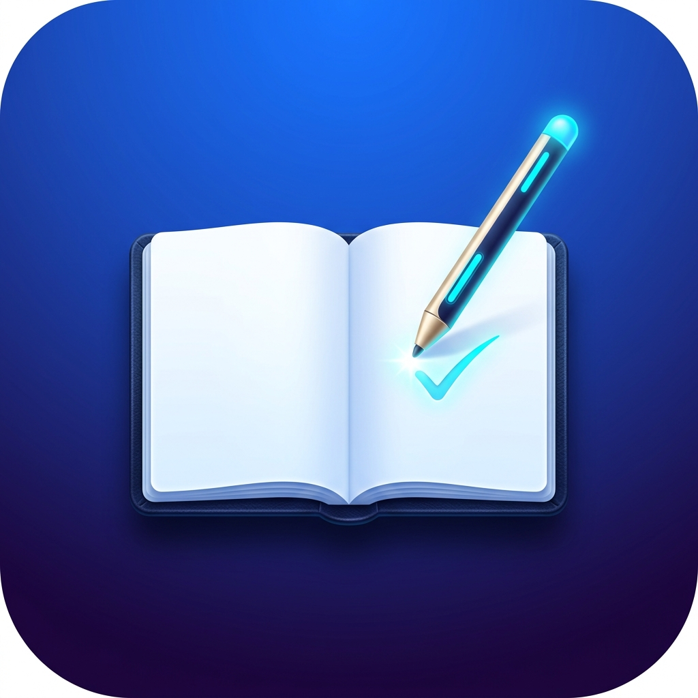

<div align="center">

  

  # 知微错题本 (ZhiWei Note)
  
  **见微知著 · 省思改错 · 本地优先 · 三端互通**

  一款专为学生、考研与考公党、程序员打造的**跨平台本地优先（Local-First）智能错题管理与深度复盘系统**。<br/>
  融合 **GoodNotes 拟物层级分类**、**Apple Pencil 压感手写草稿演练**、**多次做题历程分区**、**LaTeX 公式 / 代码块多模态笔记** 及 **Git 无服务器多端云同步**。

  <p>
    <a href="https://github.com/xuewexin/zhiwei-notebook/releases/latest"></a>
    
    
    
    
    
  </p>

</div>

---

## 📥 最新版本极速下载 (v1.5.0)

本项目提供全平台打包好的纯净安装包，无任何强制联网、无广告，下载即用：

| 平台 | 安装包名称 | 文件大小 | 适用设备与特性 | 直接下载链接 |
| :--- | :--- | :--- | :--- | :--- |
| 💻 **Windows 原生版** | `zhiwei-notebook-v1.5-windows.exe` | ~2.0 MB | **Windows 独立原生桌面软件**（双击即开、零白屏启动、自动版本比对与平滑更新） | [点击下载 EXE](https://github.com/xuewexin/zhiwei-notebook/releases/download/v1.5.0/zhiwei-notebook-v1.5-windows.exe) |
| 💻 **Windows 便携版** | `zhiwei-notebook-v1.5-windows-portable.zip` | ~1.2 MB | Windows 绿色免安装压缩包 | [点击下载 ZIP](https://github.com/xuewexin/zhiwei-notebook/releases/download/v1.5.0/zhiwei-notebook-v1.5-windows-portable.zip) |
| 🤖 **Android 原生版** | `zhiwei-notebook-v1.5-android.apk` | ~3.98 MB | 安卓手机 / 安卓平板（全新矢量图标、励志启动封面、相册录题、防误触） | [点击下载 APK](https://github.com/xuewexin/zhiwei-notebook/releases/download/v1.5.0/zhiwei-notebook-v1.5-android.apk) |
| 🍎 **iPadOS / iOS** | `zhiwei-notebook-v1.5-ipad.ipa` | ~3.45 MB | iPad 全系列 / iPhone（原生 ARM64 编译，支持爱思助手/巨魔商店侧载） | [点击下载 IPA](https://github.com/xuewexin/zhiwei-notebook/releases/download/v1.5.0/zhiwei-notebook-v1.5-ipad.ipa) |
| 🍎 **iPad 原生工程** | `zhiwei-notebook-v1.5-ios-xcode-project.zip` | ~926 KB | 包含完整 Xcode 工程源码，可在 Mac 电脑直接打开真机调试 | [点击下载工程 ZIP](https://github.com/xuewexin/zhiwei-notebook/releases/download/v1.5.0/zhiwei-notebook-v1.5-ios-xcode-project.zip) |
| 🌐 **iPad / PC 极速版** | `启动iPad局域网极速连接.bat` | 脚本文件 | **免安装、免证书、永不过期**。iPad Safari 添加到主屏幕秒变全屏桌面 App | [查看使用步骤](#-方案二ipad-专属-pwa-桌面原生体验免签名) |
| 💻 **本地运行脚本** | `启动错题本.bat` | 脚本文件 | 双击脚本即开，搭配本地 Node.js 极速做题 | [查看运行方法](#-windows-桌面端使用指南) |

---

## ✨ v1.5.0 重大更新亮点

1. 📱 **移动端排版重构与状态栏防遮挡**：
   - **底栏精炼升级**：移除了冗余的“全部科目”标签，底栏重构为清晰高效的四项核心入口：**「错题本」**、**「今日复盘」**、**「录题 +」** 与 全新 **「个人主页」**；
   - **抽屉移至左上角**：将科目抽屉菜单置于移动端左上角（Hamburger Menu），随时点击随时呼出；
   - **解决手机信息栏遮挡**：抽屉弹窗内边距自动适配移动设备 Safe-Area 顶部高度，杜绝与手机状态栏、电量、时间及前置挖孔屏冲突。
2. 👤 **全新个人主页与系统设置中心**：
   - **用户资料自定义**：支持切换/上传个性化头像照片，自由修改用户昵称与励志座右铭；
   - **6 款专属主题配置颜色**：随时切换经典知微蓝、极客深邃紫、翡翠生机绿、暖阳落日橙、优雅蔷薇粉与沉稳曜石灰；
   - **自定义背景壁纸**：支持上传本地背景图片并自由调节 5%~50% 护眼不透明度，兼具个性美感与公式阅读舒适度；
   - **存储位置与数据备份**：清晰展示当前设备存储路径（Android 沙盒 / Windows 本地目录），支持一键导出 JSON 全量题库备份与导入恢复。
3. 📑 **错题录入支持上传 PDF 试卷与可选标准答案**：
   - **原题支持 PDF 讲义/试卷**：除拍照与 Markdown 外，新增支持上传整页 PDF，可在详情页多页翻阅并手写批注；
   - **新增参考答案录入（可选）**：录题时可自由选择是否填写标准答案，支持文字解析、答案拍照与答案 PDF 附件。
4. 🤖 **AI 智能助教与复习规划接口配置**：
   - 在个人主页设置中内置 API 接口配置面板，支持直连 DeepSeek、OpenAI、Kimi、通义千问等；
   - 纯客户端本地发起请求，无需中间服务器，API Key 仅留存于本地，保障学习隐私。
5. 🎨 **全真矢量图标体系（告别原生 Emoji）**：
   - 彻底淘汰原有简陋杂乱的系统 Emoji（如 `🧠`、`📝`、`📑`、`📷`、`🔥` 等）。
   - 全面引入高精度 Lucide 矢量图标，重塑 24 种学科专属徽章、草稿页签、复盘状态机与导航系统，视觉更高级、纯粹、专业。
6. 🔄 **自动检测与覆盖式无损更新**：
   - 每次进入软件自动与 GitHub 官方仓库比对最新 Release 版本。
   - 发现新版时弹出高颜值更新提醒，支持一键直达下载覆盖升级；
   - **严格保证用户数据安全**：更新仅替换软件主程序，用户所有本地错题、分类与配置物理隔离，升级绝不丢失任何数据！
7. 🚀 **零延迟原生励志开屏封面（彻底解决开屏白窗）**：
   - 为 Windows 原生端和移动端设计高颜值极速启动封面，杜绝引擎加载时的几秒白色窗口闪烁。
   - 呈现呼吸光晕 App 徽章与每日精选励志学习名言（苏轼、孔子、《礼记》等经典名篇随机展现），平滑过渡至学习空间。

---

## 🖼️ 真实界面展示 (UI Showcase)

<div align="center">

### 💻 宽屏桌面端与 iPad 平板大屏视图
*高颜值拟物化 GoodNotes 学科封面、多级目录折叠导航、搜索与 Git 状态面板*


<br/>

### 📖 错题精细研读与多模态复盘视图
*标准解析折叠防剧透、LaTeX 数学公式渲染、历次演练做题记录与心得推导*


<br/>

### 📱 移动端与手机竖屏触控专属设计
*左图：真机实测竖屏界面（清新圆角卡片、无刷新新建分类、底部沉浸式导航） ｜ 右图：移动端学科分类流与响应式排版*

<p>
  
  
</p>

</div>

---

## 🌟 核心特色与功能深度剖析

### 1. 📂 GoodNotes 拟物化层级分类
* **多级学科与知识点归类**：自由创建一级科目（数学、物理、英语、算法等）以及无限层级子分类（例如：`数学 ➔ 函数与导数 ➔ 极值点偏移`）。
* **拟物化封面色板**：支持 8 种高雅莫兰迪色系、个性化科目图标与掌握率环形进度条。
* **无刷新流畅交互**：创建与编辑分类自由输入名称，绝无刷新丢字或位置错位烦恼。

### 2. ✍️ Apple Pencil 触控手写画板 (草稿演练与订正推导)
* **真实压感笔迹**：深度基于 PointerEvent 硬件压感引擎，支持 Apple Pencil 细致轻重顿笔。
* **手掌防误触 (Pen Only)**：开启后仅响应手写笔触，手掌贴在屏幕上演算也不会发生误涂或页面拖动。
* **多页草稿连载**：一键添加草稿页，快速保存并直接归档进当次做题记录。

### 3. 📝 三模态错题心得笔记
* 📝 **纯文本极简模式**：无干扰沉浸记录第一感觉与考场心理。
* 📖 **Markdown + LaTeX 公式模式**：内置常用公式符号栏，全面支持 行内公式（`$f'(x_0) = 0$`）与 块级公式（`$$\int_a^b f(x)dx$$`）秒级渲染。
* 💻 **代码块模式**：支持 Python、C++、Java、JS、Rust、SQL 等十余种语言高亮显示与行号统计。
* 🏷️ **错因速选标签**：审题失误、知识盲区、公式遗忘、计算失误、思维定势、分类讨论不全。

### 4. 🔄 做题历程分区 (第1次做、第2次做、第3次做...)
* 针对同一道难题建立多次复盘演练时间轴。
* 详细记录：**做题结果（完全做对 / 步骤得分 / 依然做错）**、**做题耗时（分钟）**、**演算推导草稿图**、**阶段反思笔记**。
* 联动掌握度状态机：`未掌握 ➔ 攻克复盘中 ➔ 已完全掌握`。

### 5. ☁️ 本地优先 + Git 无服务器多端云同步
* **数据 100% 属于你**：纯本地模式下所有数据存储在 IndexedDB 或本地 `data/` 目录中，即使完全断网也能秒开使用。
* **三端互通**：支持配置 Gitee (国内极速免代理) 或 GitHub 私有仓库，通过 Git 协议实现 Android、iPadOS 与 Windows 双向无缝同步，无需任何中心化收费服务器！

---

## 🚀 各端使用与安装教程

### 🤖 Android 安卓端安装
1. 在 Android 设备上下载 [**`知微错题本_v1.4_纯净版.apk`**](https://github.com/xuewexin/zhiwei-notebook/releases/download/v1.4.0/%E7%9F%A5%E5%BE%AE%E9%94%99%E9%A2%98%E6%9C%AC_v1.4_%E7%BA%AF%E5%87%80%E7%89%88.apk)。
2. 点击安装文件，允许「允许安装未知来源应用」。
3. 安装完成后打开，即可享受专门为手机端适配的抽屉侧边栏、相机扫题与双击返回防误触体验。

---

### 🍎 iPadOS / iOS 端安装

#### 方案一：使用爱思助手安装原生 `.ipa`（最推荐）
1. 下载 [**`知微错题本_iPad_v1.4.ipa`**](https://github.com/xuewexin/zhiwei-notebook/releases/download/v1.4.0/%E7%9F%A5%E5%BE%AE%E9%94%99%E9%A2%98%E6%9C%AC_iPad_v1.4.ipa) 到电脑；
2. 用数据线连接 iPad 到电脑，打开电脑端「爱思助手」；
3. 进入 **「工具箱」➔「IPA 签名」**，导入下载好的 `.ipa` 文件；
4. 选择 **「使用 Apple ID 签名」**，输入你自己的 Apple ID 即可免费签名并安装到 iPad；
5. 首次在 iPad 上打开时，进入「设置」➔「通用」➔「VPN 与设备管理」中点击「信任开发者证书」即可畅享！

#### 方案二：iPad 专属 PWA 桌面原生体验（免签名、永不过期）
1. 确保电脑与 iPad 连接在同一个 Wi-Fi 局域网下；
2. 电脑双击运行根目录下的 `启动iPad局域网极速连接.bat`；
3. 控制台会显示局域网访问地址（例如 `http://192.168.1.xxx:5173`）；
4. iPad 打开 Safari 访问该地址，点击右上角 **「分享」按钮 ➔「添加到主屏幕」**；
5. iPad 桌面自动生成专属高清图标，点击即可 100% 全屏独立运行，完美支持 Apple Pencil 压感手写与离线使用！

---

### 💻 Windows 桌面端使用指南

#### 方式一：直接运行 Windows 单文件版 EXE（最推荐 ⭐）
1. 下载 [**`zhiwei-notebook-v1.4-windows.exe`**](https://github.com/xuewexin/zhiwei-notebook/releases/download/v1.4.0/zhiwei-notebook-v1.4-windows.exe)（或下载绿色便携版 ZIP 解压）；
2. 直接双击打开即可运行！无需安装任何额外环境，独立桌面窗口、无浏览器地址栏干扰，内嵌高精度手写与本地数据引擎。

#### 方式二：一键批处理脚本启动
直接双击项目根目录下的 **`启动错题本.bat`**，系统将自动拉起本地数据存储服务与浏览器前端界面！

#### 方式三：开发者命令行启动
```bash
# 1. 克隆代码仓库
git clone https://github.com/xuewexin/zhiwei-notebook.git
cd zhiwei-notebook

# 2. 安装依赖
npm install

# 3. 启动开发服务器 (自动打开 http://localhost:5173)
npm run dev

# 4. 构建生产产物
npm run build
```

---

## 🛠️ 技术架构

```
知微错题本 (ZhiWei Note)
├── Web / UI 层: React 19 + TypeScript + Vite + TailwindCSS 4
├── 数学与代码引擎: KaTeX + PrismJS + Marked
├── 手写笔迹引擎: PointerEvent + Pressure Sensitivity + Palm Rejection
├── 跨端原生容器: 
│   ├── Windows 桌面端: .NET 9 + Microsoft Edge WebView2 (单文件独立打包)
│   ├── Android 移动端: Capacitor 8 (Android SDK 34)
│   └── iPadOS 平板端: Capacitor 8 (iOS SDK 17+ Swift Package Manager)
├── 数据持久化: 
│   ├── Client 模式: IndexedDB / LocalStorage (纯本地秒级缓存)
│   ├── Server 模式: Express + Node.js (本地磁盘文件持久化)
│   └── Cloud 模式: Git (GitHub / Gitee 双向同步通道)
└── 自动化打包: GitHub Actions (macOS-14 ARM64 Xcode Runner)
```

---

## 📄 开源许可证

本项目基于 [MIT License](LICENSE) 开源。欢迎 Star、Fork 与提交 Issue 改进！
